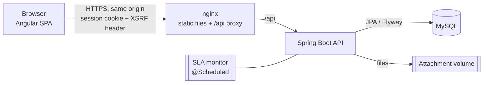

# SupportHub

An IT service management (ITSM) help desk: employees raise tickets, support agents work them in team queues against
service-level targets, and administrators manage accounts, teams and SLA policies. Built with **Spring Boot 4 (Java 25)**,
**Angular 22** and **MySQL 8**, with Flyway migrations, session-based authentication, role- and ownership-based
authorization, Docker Compose and a GitHub Actions pipeline.

> **Status:** portfolio / learning project. Every push runs the full pipeline on GitHub Actions: 290 backend tests
> (JUnit, MockMvc, H2 with the real migrations), 125 frontend tests, lint and build, both Docker images, and a
> Playwright end-to-end suite against the complete stack in Docker Compose.

## The problem it solves

Small IT teams often run support from a shared mailbox: requests get lost, nobody knows who owns what, and nobody can
say whether urgent problems are answered in time. SupportHub gives every request an owner, a queue, a status workflow,
an SLA clock and an audit trail, and gives requesters a place to follow their own tickets.

## Features

**Tickets**
- Create, view, edit; status workflow `OPEN → IN_PROGRESS ⇄ WAITING → RESOLVED → CLOSED`, plus cancel and reopen.
  The workflow is enforced in the domain model; the API tells each caller which moves *they* may make.
- Priorities LOW / MEDIUM / HIGH / CRITICAL, categories (hardware, software, network, access, email, other).
- Server-side paging, sorting and combinable filters: status, priority, category, team, agent, requester, creation
  date range, text / ticket-number search, and queues (*my tickets*, *assigned to me*, *team*, *unassigned*).
- Optimistic locking: concurrent edits are detected (HTTP 409) instead of silently overwritten.

**Collaboration**
- Public comments and **internal notes** (staff only, filtered out on the server for requesters everywhere: comments,
  activity, notifications, search).
- Activity timeline of every change (status, priority, category, assignment, comments, attachments, SLA breaches).
- Attachments (PNG, JPEG, PDF, TXT, LOG; max 5 MB) with content-type sniffing, filename sanitising and authorised
  downloads.
- Persistent in-app notifications (assignment, comments, status changes, resolution, reopening, SLA warnings and
  breaches) with unread count, mark-as-read and mark-all-as-read.

**Service management**
- Teams with members; assignment to agents and/or teams with validation (active accounts and teams only, agent must be
  a team member), assignment history and workload per agent and team.
- SLA per priority (configurable): first-response and resolution deadlines, at-risk / breached status, clock paused
  while waiting for the requester, fresh resolution target on reopen; a scheduled monitor sends warnings and breach
  notifications once.
- Dashboard computed by the database and scoped to what the caller may see: KPI tiles, status / priority / category
  distribution, created-vs-resolved trend, SLA compliance, average resolution time, agent and team workload (staff).

**Administration and accounts**
- Users: paged search, create (role defaults to USER), edit, deactivate (ends sessions, unassigns active tickets),
  password reset. Own profile and password change for everyone.
- Roles ADMIN, SUPPORT_AGENT, USER, enforced on the server (URL rules, method security and per-ticket checks).

## Technology

| Layer | Stack |
|---|---|
| Backend | Java 25, Spring Boot 4.1 (Web MVC, Data JPA / Hibernate 7, Security 7, Validation, Actuator), Flyway, springdoc-openapi 3 |
| Database | MySQL 8.0.19+ (H2 in MySQL mode for tests, running the same migrations) |
| Frontend | Angular 22 (standalone components, signals, strict TypeScript and templates), RxJS, Vitest |
| Testing | JUnit 5, Mockito, MockMvc, Spring Security Test, Vitest, Playwright |
| Delivery | Docker (multi-stage images), Docker Compose, nginx, GitHub Actions |

## Architecture



The backend is organised by feature (`ticket`, `assignment`, `comment`, `activity`, `sla`, `notification`,
`attachment`, `dashboard`, `team`, `user`, `auth`, `error`). Controllers are thin; services own the rules and return
DTOs only (entities never leave the service layer). All ticket permission rules live in one class,
`TicketAccessPolicy`, used both as a SQL predicate (lists, dashboard) and for single-ticket checks.
Details, the data model (ER diagram) and the request flow: [docs/ARCHITECTURE.md](docs/ARCHITECTURE.md).

## Screenshots

Add screenshots to `docs/screenshots/` and link them here. Suggested set (see [docs/DEMO.md](docs/DEMO.md)):
dashboard (agent), ticket list with filters, ticket detail with an internal note, user administration, SLA settings.

## Getting started

### Option A: Docker (recommended)

Prerequisites: Docker with Compose v2.

```bash
cp .env.example .env        # then change the passwords in .env
docker compose up --build
```

Open <http://localhost:8080> and sign in with the bootstrap administrator from `.env`
(`BOOTSTRAP_USER_USERNAME` / `BOOTSTRAP_USER_PASSWORD`). The account is created only when the database has no
accounts; set `BOOTSTRAP_USER_ENABLED=false` afterwards. Data lives in the `db-data` and `attachments` volumes
(`docker compose down -v` deletes them). The API is also reachable on `http://127.0.0.1:8081` (Swagger UI when
`SPRING_PROFILES_ACTIVE=dev`).

Compose runs over plain http on localhost, so it turns `Secure` cookies off; anything beyond local use needs TLS in
front and `SESSION_COOKIE_SECURE=true`.

### Option B: run locally without Docker

Prerequisites: JDK 25, Node.js 22 (npm 10), MySQL 8.0.19 or later.

1. Create a database and user:
   ```sql
   CREATE DATABASE support_ticket_tracker CHARACTER SET utf8mb4 COLLATE utf8mb4_0900_ai_ci;
   CREATE USER 'supporthub'@'localhost' IDENTIFIED BY 'choose-a-password';
   GRANT ALL PRIVILEGES ON support_ticket_tracker.* TO 'supporthub'@'localhost';
   ```
   The application user needs DDL rights because Flyway creates the schema at startup.
2. Backend (PowerShell shown; use `export` on macOS/Linux):
   ```powershell
   cd backend
   $env:DB_USERNAME="supporthub"; $env:DB_PASSWORD="choose-a-password"
   $env:SPRING_PROFILES_ACTIVE="dev"
   $env:BOOTSTRAP_USER_ENABLED="true"; $env:BOOTSTRAP_USER_USERNAME="admin"
   $env:BOOTSTRAP_USER_EMAIL="admin@example.com"; $env:BOOTSTRAP_USER_PASSWORD="Change-me-123"
   .\mvnw spring-boot:run
   ```
   API on <http://localhost:8080>; Swagger UI at <http://localhost:8080/swagger-ui.html> (dev profile only);
   health at <http://localhost:8080/actuator/health>.
3. Frontend:
   ```bash
   cd frontend
   npm ci
   npm start            # http://localhost:4200, proxies /api to :8080
   ```

### Environment variables

All configuration comes from the environment; nothing secret is in the repository. See [.env.example](.env.example).

| Variable | Default | Purpose |
|---|---|---|
| `DB_HOST`, `DB_PORT`, `DB_NAME` | `localhost`, `3306`, `support_ticket_tracker` | Database location |
| `DB_USERNAME`, `DB_PASSWORD` | – (required) | Database credentials |
| `SPRING_PROFILES_ACTIVE` | none | `dev` enables Swagger UI, non-Secure cookies and CORS for `localhost:4200` |
| `SESSION_COOKIE_SECURE` | `true` | `Secure` flag on session and XSRF cookies |
| `CORS_ALLOWED_ORIGINS` | empty | Extra browser origins (only for cross-origin deployments) |
| `BOOTSTRAP_USER_*` | disabled | First account on an empty database (`ROLE` default ADMIN) |
| `ATTACHMENTS_DIR` | `./data/attachments` | Where uploaded files are stored (outside any web root) |
| `SLA_MONITOR_ENABLED` | `true` | Scheduled SLA warning/breach notifications |
| `FLYWAY_BASELINE_ON_MIGRATE` | `false` | One-off adoption of a pre-Flyway database (below) |
| `MYSQL_ROOT_PASSWORD` | – | Docker only: root password of the MySQL container |

### Initial administrator

There is no built-in account and no public registration. Either use the bootstrap variables above on an empty
database, or promote an existing account once with SQL:
`UPDATE app_users SET role = 'ADMIN' WHERE username = 'your-name';`. After that, administrators create all other
accounts under **Administration → Users**.

## Database and migrations

Flyway owns the schema (`backend/src/main/resources/db/migration`, V1–V12); Hibernate only validates it
(`ddl-auto=validate`) in every profile, and the tests run the same migrations on H2. All migrations are additive;
existing tickets get category `OTHER`, no requester (visible to staff only) and no SLA until reopened.
V8 uses `ALTER TABLE ... DROP CONSTRAINT`, which needs **MySQL 8.0.19 or later**.

### Adopting an existing database

A new, empty database needs nothing. If you already have a database that an earlier version created through
Hibernate (`ddl-auto=update`), Flyway refuses to start against it, on purpose. Adopt it once:

1. **Back up the database.**
2. Bring the table to the V1 shape (adjust if `DESCRIBE tickets` shows a column already matches; skip `ADD COLUMN`
   for columns that exist):

   ```sql
   UPDATE tickets SET created_at = COALESCE(created_at, NOW(6)), updated_at = COALESCE(updated_at, NOW(6));
   ALTER TABLE tickets
       MODIFY COLUMN title       VARCHAR(150)  NOT NULL,
       MODIFY COLUMN description VARCHAR(2000) NOT NULL,
       MODIFY COLUMN status      VARCHAR(20)   NOT NULL,
       MODIFY COLUMN priority    VARCHAR(20)   NOT NULL,
       MODIFY COLUMN created_at  DATETIME(6)   NOT NULL,
       MODIFY COLUMN updated_at  DATETIME(6)   NOT NULL;
   ALTER TABLE tickets ADD COLUMN resolved_at DATETIME(6) NULL;
   ALTER TABLE tickets ADD COLUMN version BIGINT NOT NULL DEFAULT 0;
   ```

   Converting an `enum(...)` column to `VARCHAR` keeps every value. `status` must only contain `OPEN`,
   `IN_PROGRESS`, `RESOLVED`, `CLOSED` or `CANCELLED`, and `priority` only `LOW`, `MEDIUM` or `HIGH`.
3. Start the application once with `FLYWAY_BASELINE_ON_MIGRATE=true`. Flyway records V1 as already applied and runs
   V2 onwards (V2 fails, without changing data, if any row violates a constraint - fix the row and restart).
4. Remove the variable. It is not needed again.

No data is deleted by any of these steps. Timestamps written by older versions used the server's local time zone;
they are not converted, so on a server that was not running in UTC they read as UTC and appear shifted by the offset.

## Testing

| What | Command | Notes |
|---|---|---|
| Backend unit + integration tests | `cd backend && ./mvnw verify` | JUnit 5, Mockito, MockMvc, H2 with the real migrations; 290 tests; no MySQL needed |
| Frontend unit tests | `cd frontend && npm run test:ci` | Vitest, 125 tests |
| Frontend lint | `npm run lint` | strict `tsc` for app, specs and E2E, plus Prettier |
| Frontend build | `npm run build` | production bundle |
| End-to-end | `docker compose up -d` then `cd frontend && npx playwright install chromium && E2E_ADMIN_PASSWORD=... npm run e2e` | Playwright against the running stack; creates its own test accounts |

The CI pipeline (`.github/workflows/ci.yml`) runs all of these, builds both Docker images and runs the E2E suite
against `docker compose`. Strategy and coverage: [docs/TESTING.md](docs/TESTING.md).

## API

- Swagger UI / OpenAPI: `/swagger-ui.html` and `/v3/api-docs` with `SPRING_PROFILES_ACTIVE=dev`.
- Every error has the same JSON shape: `{timestamp, status, error, message, fieldErrors}`.
- Lists are paged: `{content, page, size, totalElements, totalPages, hasNext, hasPrevious}`.
- Endpoint overview and conventions: [docs/API.md](docs/API.md).

## Authentication and authorization

- **Authentication:** server-side session (HttpOnly `JSESSIONID`, SameSite=Lax, Secure by default), started by
  `POST /api/auth/login`; CSRF protection with the `XSRF-TOKEN` cookie / `X-XSRF-TOKEN` header (Angular's built-in
  support); BCrypt password hashes; session fixation protection; one generic error for every failed sign-in;
  5 failed attempts per username within 15 minutes → HTTP 429. Accounts are re-checked on every request, so
  deactivation and role changes apply immediately.
- **Authorization:** URL rules (`/api/admin/**` ADMIN), method security (`@AdminOnly`, `@StaffOnly`, `@AnyRole`) and
  ownership/team checks in the services (`TicketAccessPolicy`). Tickets a caller may not see answer 404 like missing
  ones. The Angular route guards only shape navigation.

| | USER | SUPPORT_AGENT | ADMIN |
|---|---|---|---|
| See tickets | own | own + assigned + team + general queue | all |
| Edit details | own, while OPEN | tickets they work on | all |
| Status | cancel own; reopen/close own when RESOLVED | full workflow on tickets they work on | full workflow |
| Internal notes | never | on tickets they work on | yes |
| Assign | – | tickets they work on | yes |
| Delete tickets / comments | – | – | yes |
| Users, teams, SLA | – | – (read teams) | yes |

Full model, flows and security notes: [docs/ARCHITECTURE.md](docs/ARCHITECTURE.md), [docs/SECURITY.md](docs/SECURITY.md).

## Known limitations

- The automated tests run on H2 in MySQL mode; MySQL 8 itself is exercised by the Docker Compose stack (manual
  testing and the end-to-end suite), not by the unit/integration suite.
- The end-to-end suite covers the main workflow (5 scenarios); edge cases are covered by the backend integration tests.
- SLA uses calendar time (no business hours or holidays). Ticket categories are a fixed list.
- Login throttling is in memory and per instance; no password-reset e-mail; no e-mail notifications (the
  `NotificationChannel` interface is the extension point).
- Text attachments must be UTF-8. Attachments are stored on the local file system (one volume).
- No dark theme; the UI is English only.

## Future improvements

Business-hours SLA calendars, e-mail notifications and inbound e-mail tickets, knowledge base articles, ticket
templates, saved filters, CSV export, object storage for attachments, a shared store for rate limiting, and
lazy-loaded Angular routes.

## Project documentation

- [docs/ARCHITECTURE.md](docs/ARCHITECTURE.md) – components, data model, request and authentication flow
- [docs/SECURITY.md](docs/SECURITY.md) – protections, review results and remaining risks
- [docs/SLA.md](docs/SLA.md) – how deadlines and compliance are calculated
- [docs/TESTING.md](docs/TESTING.md) – test strategy and what each suite covers
- [docs/API.md](docs/API.md) – endpoint overview
- [docs/DEMO.md](docs/DEMO.md) – demo walkthrough and screenshot list
- [docs/AI_PROGRESS.md](docs/AI_PROGRESS.md) – development log, verification status and learning notes
