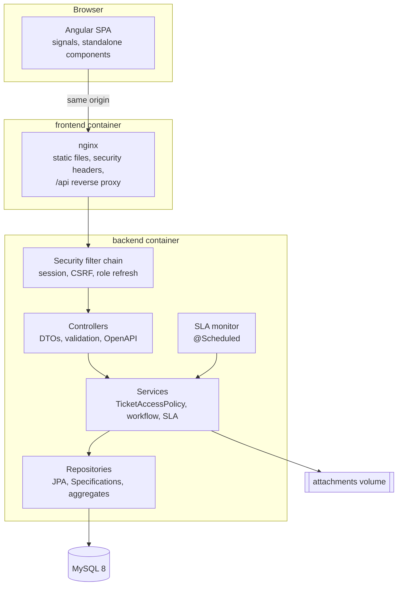
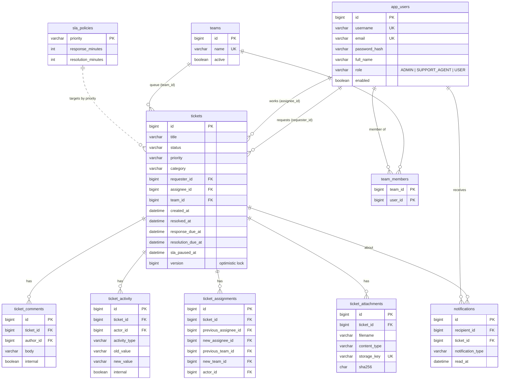
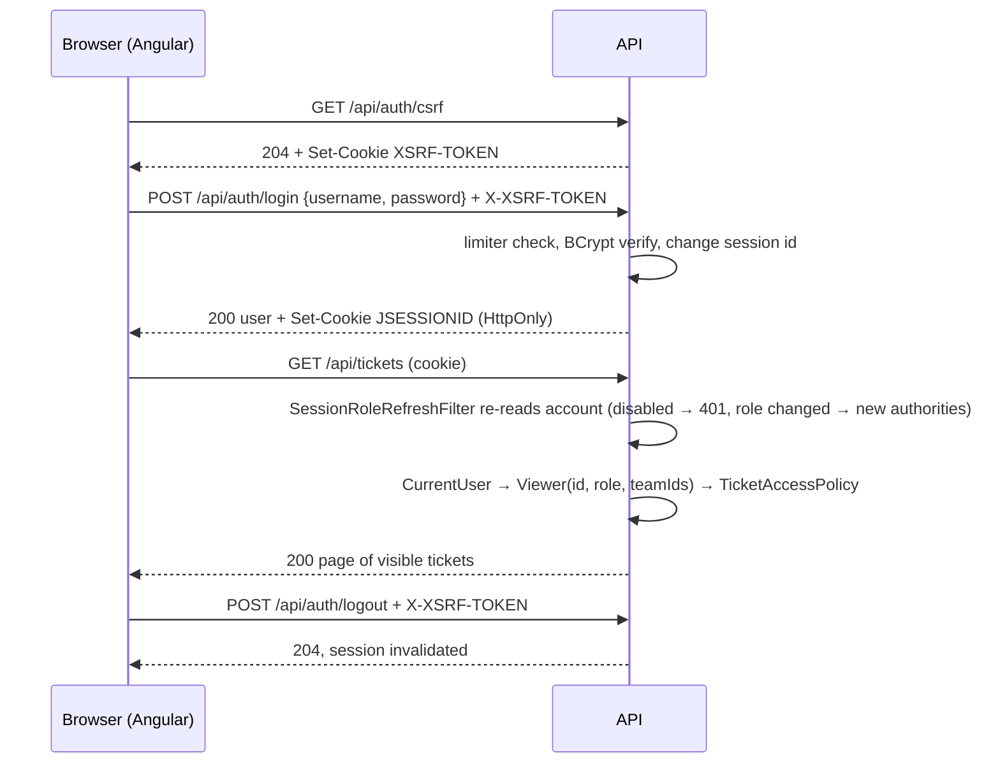

# Architecture

## Components

The browser only ever talks to one origin (nginx in Docker, the Angular dev-server proxy locally), so the session and
CSRF cookies work without CORS.

## Backend packages

| Package | Responsibility |
|---|---|
| `auth` | Security configuration, login/logout/me, CSRF bootstrap, role annotations, `CurrentUser` / `Viewer`, login limiter |
| `user` | Accounts, roles, password policy, admin user management, own profile, staff lookup |
| `team` | Teams and membership |
| `ticket` | Ticket entity and workflow, `TicketAccessPolicy`, list query/specifications, ticket service and API |
| `assignment` | Assigning agents/teams, assignment history |
| `comment` | Public comments and internal notes |
| `activity` | Activity timeline (written by the other services) |
| `sla` | SLA policies, `SlaMath`, per-ticket SLA bookkeeping, scheduled monitor |
| `notification` | Persistent in-app notifications and the `NotificationChannel` extension point |
| `attachment` | Upload validation, storage abstraction (`AttachmentStorage`), authorised download |
| `dashboard` | Aggregate statistics and workload |
| `error` | `GlobalExceptionHandler`, `ApiError` and shared exceptions |

### Key design decisions

- **One permission policy.** `TicketAccessPolicy` defines who may see and do what with a ticket. Its `visibility()`
  method builds a JPA `Predicate`, so the same rule filters lists and dashboard queries in SQL; its boolean methods
  check single tickets. `TicketLookup` loads a ticket for any sub-resource (comments, activity, attachments,
  assignment) and applies it, so no endpoint can forget the check.
- **404 instead of 403 for invisible tickets.** A ticket you may not see behaves exactly like one that does not exist,
  so ids cannot be probed. 403 is used only where the caller can see the resource but not perform the action.
- **The workflow lives in the entity.** `Ticket.changeStatus()` is the only way to change status and rejects
  transitions the workflow forbids (409). `TicketStatusChanger` adds the side effects (permissions, SLA, activity,
  notifications) and is shared by the API and automatic moves.
- **Dual mapping of foreign keys.** Requester, assignee and team are lazy associations *and* read-only id columns;
  queries filter on the id columns (no joins), changes go through the associations; the list query fetches the
  associations with an entity graph (no N+1).
- **Aggregates in SQL.** Dashboard and workload use `COUNT`/`AVG ... GROUP BY`; only the trend loads a single
  timestamp column for at most 90 days.
- **Side effects in the same transaction.** Activity entries and notifications are written with
  `Propagation.MANDATORY`, so they exist exactly when the change they describe was committed. Attachment files are
  deleted after commit, and removed again if the insert rolls back.

## Data model

Children of a ticket are removed with it (`ON DELETE CASCADE`); accounts are deactivated, never deleted. Status,
priority, category and role are `VARCHAR` with `CHECK` constraints. All timestamps are UTC (`DATETIME(6)`).

## Authentication flow

On a 401 from any API call the Angular interceptor ends the local session and redirects to `/login?returnUrl=…`;
on the "Invalid or missing CSRF token" 403 it fetches a token and retries once.

## Frontend structure

`src/app/` is organised by feature: `auth` (login, guards, interceptor), `dashboard`, `tickets` (list, detail, form,
API, models), `admin` (users, teams, SLA), `profile`, `inbox` (persistent notifications), `shared` (badges, charts,
confirmation dialog, toasts, formatting). State is held in signals inside components and small root services; there is
no global store because no state is shared widely enough to need one. All data comes from the API; the UI never
computes permissions or SLA status itself (it renders `permissions`, `allowedTransitions` and `sla` from the server).
